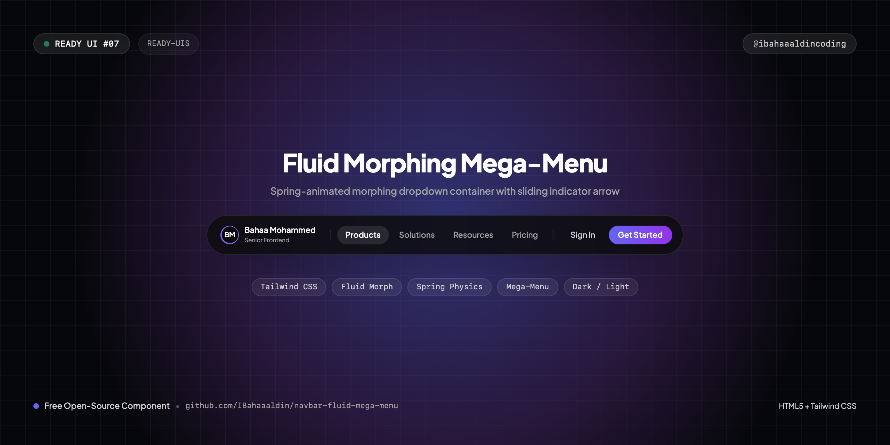
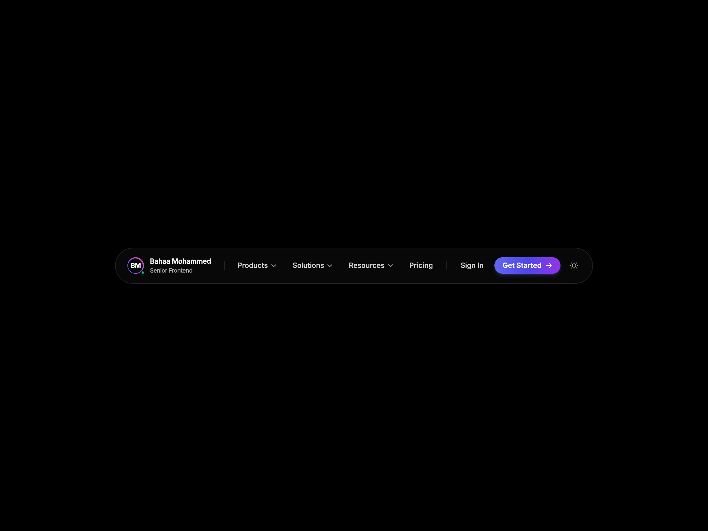
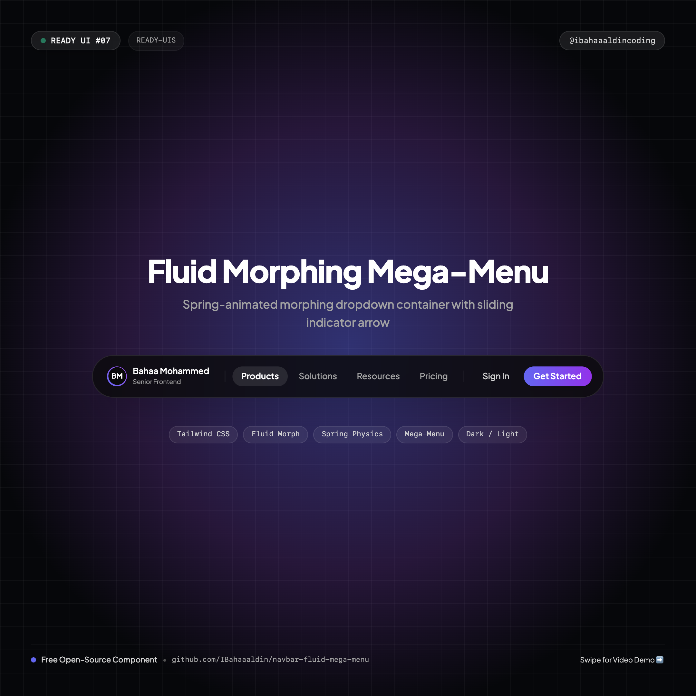
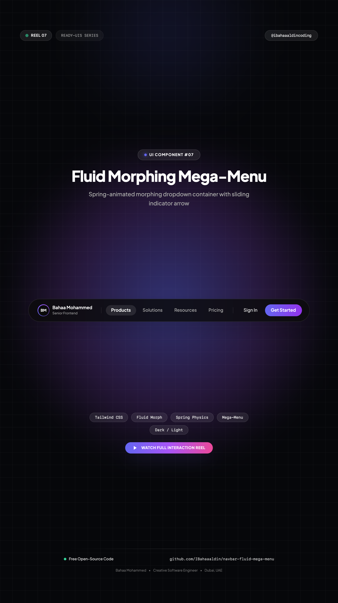

# 🌊 Fluid Morphing Mega-Menu Navbar

> A high-craft, production-ready frontend navigation bar featuring fluid morphing container mechanics inspired by Stripe, Supabase, and Raycast.



[](https://IBahaaaldin.github.io/navbar-fluid-mega-menu/)
[](https://IBahaaaldin.github.io/navbar-fluid-mega-menu/)

---

## 🌐 Visual Previews

| Desktop Showcase (1200x900) | Mobile Showcase (390x844) | Post Cover (1080x1080) | Reel Cover (1080x1920) |
| :---: | :---: | :---: | :---: |
|  |  |  |  |

*(Includes full interaction videos: `video-desktop.mp4` and `video-mobile.mp4`)*

---

## ✨ Features & Micro-Interactions

- **Fluid Morphing Container**: As you hover between navigation tabs (*Products*, *Solutions*, *Resources*), the dropdown container dynamically animates its width, height, and horizontal offset with spring physics (`cubic-bezier(0.16, 1, 0.3, 1)`).
- **Gliding Indicator Arrow**: A top pointer arrow tracks the active tab trigger seamlessly across transitions.
- **Cross-Fade & Slide**: Internal tab sections cross-fade with directional spatial slide.
- **Instant Dark / Light Mode**: Seamlessly toggles between `#000000` pitch black and `#ffffff` pure white backdrops with matching frosted glass styling.
- **Strict Single-Row Typography**: All badges, titles, and creator tags utilize `whitespace-nowrap` to prevent awkward line breaks.
- **Centered Canvas**: Placed dead-center horizontally and vertically across desktop and mobile screens.
- **Mobile Responsive Drawer**: Mobile header with brand badge, theme switch, and expandable accordion drawer with micro-interactions.
- **Zero Build Step**: Drop-in ready HTML5, Tailwind CSS CDN, and vanilla JS.

---

## 📁 Repository Structure

```text
├── index.html              # Standalone production navbar component
├── cover.png               # Widescreen cover banner (1280x640)
├── cover-instagram.png     # Square post cover for Instagram (@ibahaaaldincoding) (1080x1080)
├── cover-reel.png          # 9:16 vertical cover for Instagram Reels (1080x1920)
├── screenshot-desktop.png  # Desktop visual preview (1200x900)
├── video-desktop.mp4       # Desktop interaction recording (MP4)
├── screenshot-mobile.png   # Mobile visual preview (390x844)
├── video-mobile.mp4        # Mobile interaction recording (MP4)
├── record.js               # Playwright automation script used to record all 4 assets
├── README.md               # Documentation & setup notes
└── CAPTION.md              # Ready-to-copy Instagram caption for @ibahaaaldincoding
```

---

## 🚀 Quick Start

### 1. View Locally
Simply open `index.html` in your browser:
```bash
open index.html
```

### 2. Re-record Assets
To re-record desktop & mobile screenshots and videos:
```bash
node record.js
```

---

## 👤 Author & Connect

**Bahaa Mohammed**
Creative Developer & Software Engineer
- 📸 **Instagram**: [@ibahaaaldincoding](https://www.instagram.com/ibahaaaldincoding)
- 🐙 **GitHub**: [@IBahaaaldin](https://github.com/IBahaaaldin)
- 💼 **LinkedIn**: [Bahaa Mohammed](https://www.linkedin.com/in/bahaa-mohammed-371259369)
- 📧 **Email**: bahaam.coding@gmail.com

---

## 📄 License

MIT © [Bahaa Mohammed](https://github.com/IBahaaaldin)
